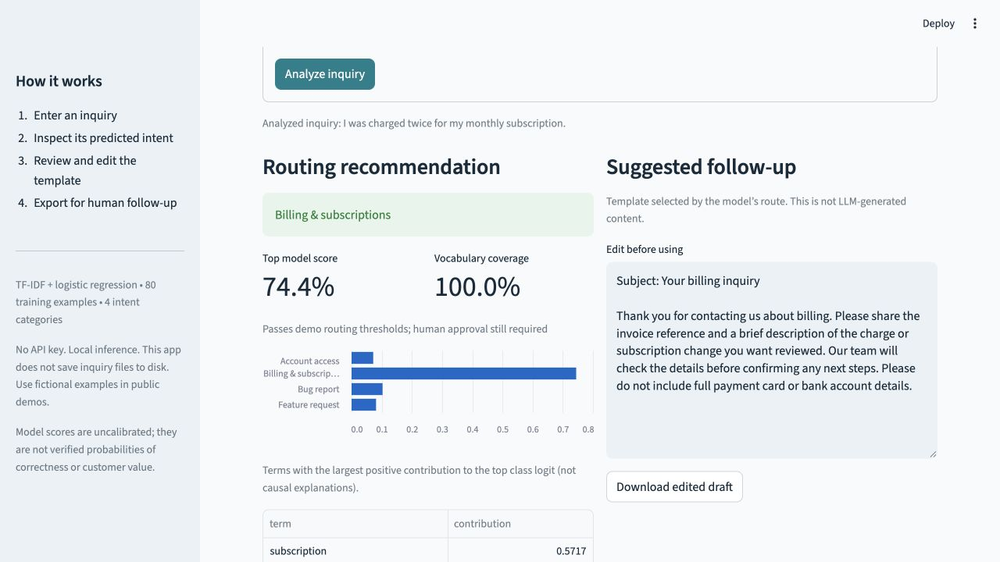

# Support Triage AI

A lightweight customer-support assistant for small software teams. Classify incoming messages, inspect the model's evidence, and prepare an editable first-response draft.

**Python · scikit-learn · Streamlit · Local inference · No API key**

[中文指南](docs/GUIDE_ZH.md) · [Model card](docs/MODEL_CARD.md) · [Evaluation](reports/evaluation.md) · [Project brief](docs/PROJECT_BRIEF.md)



## The problem

A small SaaS team often receives payment questions, login problems, bug reports, and product suggestions in the same inbox. Sorting these messages and asking for missing information is repetitive. Support Triage AI provides a reviewable first step: a suggested queue, supporting words, and a response template. A person decides what to do next.

## Features

- Four intents: **billing & subscriptions**, **account access**, **bug report**, **feature request**.
- Single-message analysis with class scores and influential text features.
- Editable response templates tailored to the suggested queue.
- CSV batch processing, per-row validation, and review-queue export.
- Manual-review fallback for uncertain or unfamiliar messages.
- Reproducible training and evaluation, automated tests, and GitHub Actions.

The AI component is a learned text classifier, not a keyword lookup. Replies are authored templates, not LLM-generated answers. No emails are sent, refunds issued, or account settings changed.

## Quick start

Tested with **Python 3.12**. From the repository root:

```bash
python3.12 -m venv .venv
source .venv/bin/activate
python -m pip install -r requirements-dev.txt
python -m streamlit run app.py
```

On Windows, create the environment with `py -3.12 -m venv .venv`, then activate using `.venv\Scripts\Activate.ps1`. Open the local URL shown in the terminal, normally `http://localhost:8501`.

The app trains from the bundled training CSV on its first load and caches the model in memory. Initial dependency installation needs internet access; training and inference do not. For the exact locally installed dependency versions, use `requirements-lock.txt` instead. This is a Python 3.12 environment snapshot, not a cross-platform guarantee.

## Demo walkthrough

1. Select **Billing** and click **Analyze inquiry**.
2. Inspect the queue, class scores, and feature contributions.
3. Edit the first-response draft and download it.
4. Try **Unclear inquiry** to see manual review.
5. In **Batch workspace**, click **Analyze sample inbox** and export the results.

CSV uploads require a UTF-8 `text` column and allow up to 200 rows / 2 MB. Other columns are ignored. Blank or overlong inquiries become invalid rows without stopping the rest of a valid batch. Download [sample_inquiries.csv](data/sample_inquiries.csv) for the format. Exports contain the original inquiry text and escape formula-like strings for spreadsheets.

## How the model works

```text
Labeled training messages -> TF-IDF -> logistic regression
                                              |
New message -> fitted TF-IDF -> intent scores -> review checks
                                              |
                           suggested queue + evidence + template
                                              |
                                  human review and editing
```

TF-IDF encodes words and two-word phrases. Logistic regression learns class-specific weights from labeled messages. The top score, top-two margin, vocabulary coverage, and a simple language heuristic determine whether a specific route can be suggested. Explanations show positive TF-IDF × coefficient contributions to the top class logit, not causal reasoning.

This deliberately small baseline is inexpensive, quick to train, and easy to inspect. It needs no GPU, pretrained model, external model service, or API credentials.

## Evaluation and tests

```bash
python -m pytest -q
python -m support_ai.evaluate
```

Evaluation writes [evaluation.md](reports/evaluation.md) and [evaluation.json](reports/evaluation.json), including per-class scores, confusion matrix, routing coverage, and review/error cases. GitHub Actions runs the same commands after publication.

There are **80 training, 16 validation, 24 held-out test, and 10 review challenge examples**. All are authored synthetic messages. Only `train.csv` is fitted; validation and test text never enter the vocabulary or classifier training. Thresholds are fixed demo heuristics, not optimized on the test set.

**These small synthetic datasets do not demonstrate production accuracy.** Messages share an author and writing style. The model can misunderstand negation, mixed intents, and unfamiliar language, including with high scores. Model scores are uncalibrated and are not customer importance or churn predictions. All drafts need review even when a route passes the thresholds. The sample-inbox examples are training examples for a predictable walkthrough; they are not an evaluation set.

Tests cover the four demo routes, abstention, malformed inputs, CSV size/row limits, export escaping, split isolation, and Streamlit interaction flows.

Local verification: **26 tests passed** on Python 3.12.14. The 24 synthetic test messages had 100% top-label accuracy, but routing coverage was only 58.3%; the review challenge recall was 70% (7/10). Missed challenge cases are recorded in the report rather than hidden. These figures do not establish production performance.

## Repository layout

```text
app.py                    Streamlit interface
support_ai/model.py       Training, prediction, evidence, templates
support_ai/batch.py        CSV import, batch processing, export
support_ai/evaluate.py     Reproducible evaluation
 data/                    Synthetic datasets and sample inbox
 tests/                   Model, input handling, and UI tests
 docs/                    Chinese guide, model card, project brief
 reports/                 Metrics and local verification
```

## Repository and hosting

Repository: [zhaoyilii/support-triage-ai](https://github.com/zhaoyilii/support-triage-ai)

```bash
git clone https://github.com/zhaoyilii/support-triage-ai.git
cd support-triage-ai
```

Then follow the quick-start instructions above. GitHub Actions tests pushes and pull requests.

Hosting is optional: this is a Python server application, so GitHub Pages cannot execute it. On a Python-capable host, install `requirements.txt` and run `python -m streamlit run app.py` with Python 3.12. A public demo should use fictional messages only. No hosted deployment is provided.

## Limits and next steps

This app has no authentication, CRM connection, audit log, or real support integration. Input remains in session memory; downloaded files contain message text. Telemetry is disabled in the Streamlit configuration. Hosted usage changes who can access the input.

A useful next iteration would collect consented, anonymized tickets and independent labels, add a support/other category, handle multiple intents, and measure routing quality and handling time against manual triage. No time savings or customer-satisfaction improvement has been measured yet.

Technical references: [TF-IDF](https://scikit-learn.org/stable/modules/generated/sklearn.feature_extraction.text.TfidfVectorizer.html), [logistic regression](https://scikit-learn.org/stable/modules/generated/sklearn.linear_model.LogisticRegression.html), [Streamlit](https://docs.streamlit.io/).

MIT license. See [LICENSE](LICENSE).
